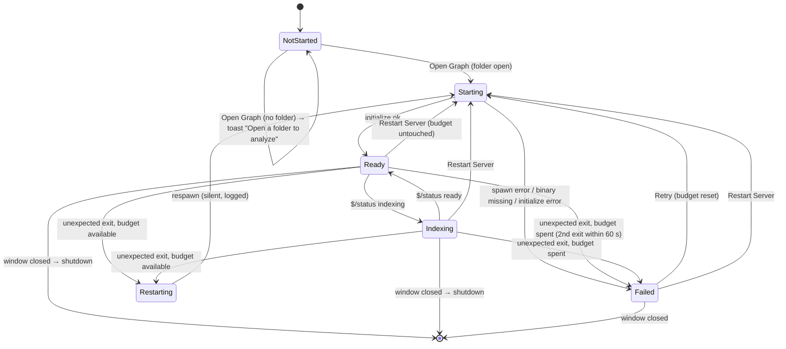
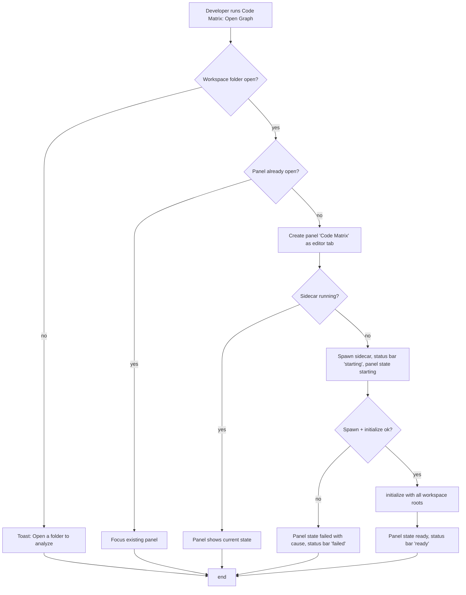
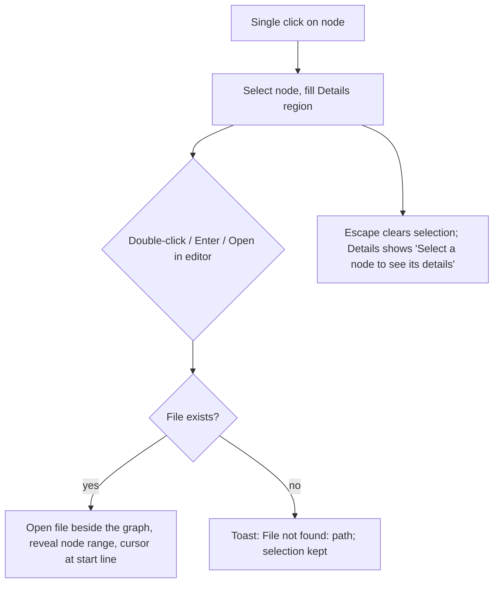
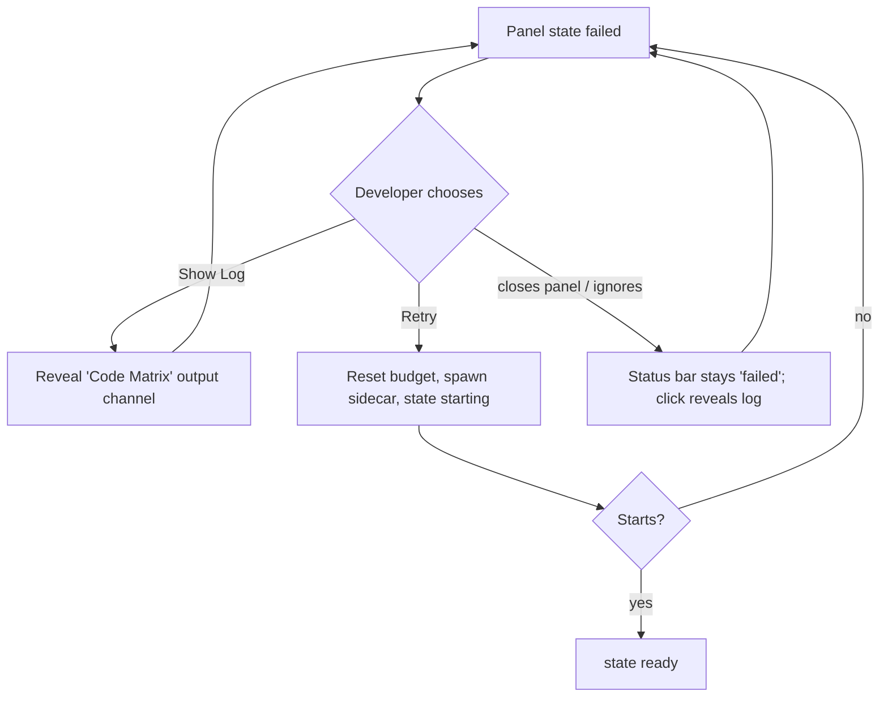

# App Shell — Flows

## Sidecar lifecycle

The state the status bar and the graph panel both display. One sidecar per window.

Budget: one silent restart. The budget is spent when a second unexpected exit happens within
60 s of the previous one; it is restored by a successful 60 s of uptime or by `Retry`.
`Restart Server` is user-initiated and never counts as an unexpected exit.

**Rules**: R2, R4, R5, R6, R7, R11

## Open the graph

**Rules**: R1, R2, R3, R4, R7, R11

## Jump to source

**Rules**: R8, R9

## Recover from a failed sidecar

Abandonment: closing the panel in the failed state leaves the status bar at `failed`; nothing
retries on its own.

**Rules**: R5, R6, R7, R10
