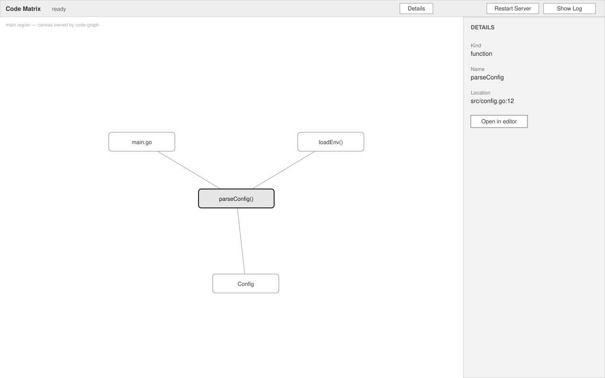
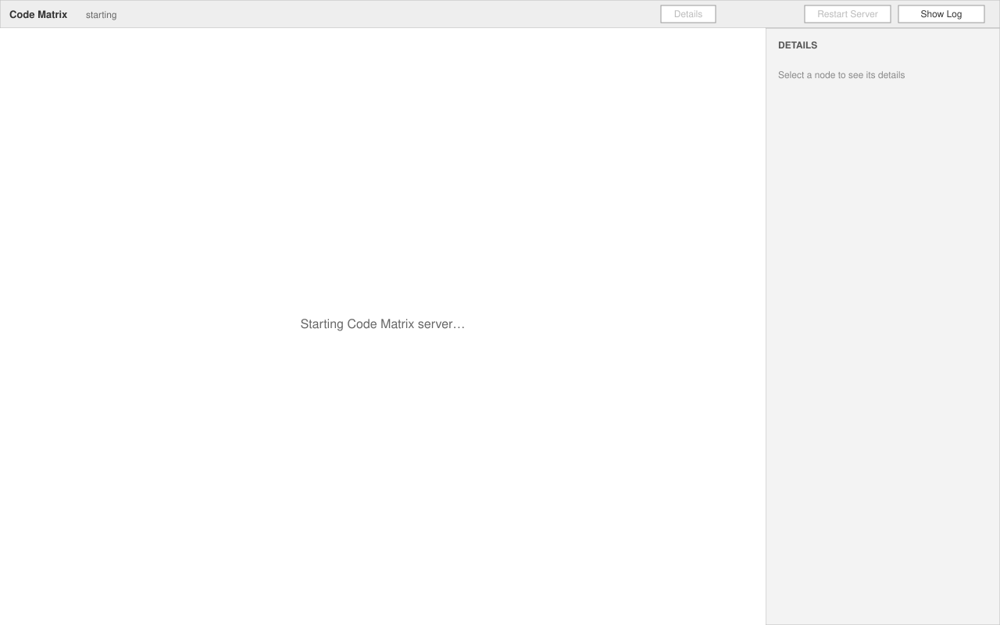
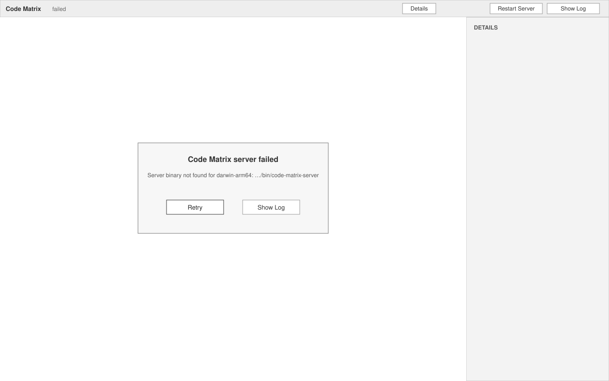

# App Shell — UI

The shell owns two surfaces: the **graph panel** (an editor tab) and the **status bar item**.
Everything else (`code-graph`, `workspace-index`, `data-flow`) renders inside the panel's regions
named here. VS Code message toasts used by the shell are listed at the end.

## Graph panel

Editor tab titled **Code Matrix**. One per window (R1). Opened by `Code Matrix: Open Graph`, by
clicking the status bar item, or by "Retry"/"Show Log" flows below.

**Regions** (other features cite these names):
- **Toolbar** — top strip, 36 px. Left: `Code Matrix` label and the sidecar state text
  (same wording as the status bar). Right: buttons `Restart Server`, `Show Log`. Other features
  add their controls (search, filters, flow stepper) to the toolbar's middle.
- **Main region** — the canvas. The shell draws nothing here in the populated state;
  `code-graph` owns it. The shell only draws the starting / indexing / failed overlays.
- **Details region** — right side, 300 px, collapsible with the `Details` toggle on the
  toolbar. Shows the selected node. Field order: `Kind`, `Name`, `Location` (as
  `path:line`), then a button `Open in editor`. Features may append their own sections below.

**Contents (populated)**: toolbar as above with state `ready`; canvas filled by `code-graph`;
details for the selected node, e.g. Kind `function`, Name `parseConfig`,
Location `src/config.go:12`, button `Open in editor`.

**States**:
- **starting** — canvas shows the centered text `Starting Code Matrix server…`; toolbar buttons
  disabled; details region shows `Select a node to see its details`. (SVG below.)
- **indexing** — canvas shows the centered text `Indexing workspace…`; the progress itself is
  `workspace-index`'s. Toolbar enabled. Not a separate SVG: same layout as starting with the
  text swapped.
- **populated** — canvas owned by `code-graph`; details show the selected node, or
  `Select a node to see its details` when nothing is selected.
- **failed** — canvas replaced by the failure overlay: heading `Code Matrix server failed`,
  the cause on one line (e.g. `Server binary not found for darwin-arm64: <path>` or
  `Process exited with code 101`), buttons `Retry` and `Show Log`. Details region empty.
  (SVG below.)
- **closed** — the tab is closed; the sidecar keeps running (R4). Re-opening returns to the
  current sidecar state without restarting it.

**Behavior**:
- Single click on a node selects it and fills the details region (R8).
- Double-click on a node, Enter with the panel focused, or `Open in editor` opens the node's
  file beside the graph at its range (R8). If the file is gone, the toast
  `File not found: <path>` appears and the selection stays (R9).
- `Restart Server` stops and restarts the sidecar; the panel passes through **starting** (R5, R7).
- `Show Log` reveals the `Code Matrix` output channel (R10).
- `Retry` (failed state only) resets the restart budget and starts the sidecar; the panel
  passes through **starting** (R6).
- Keyboard: Enter opens the selected node; Escape clears the selection.

**Rules**: R1, R4, R5, R6, R8, R9, R10, R11

## Status bar item

Left-aligned status bar entry, shown only once the sidecar has been started for the first time
in this window (R4).

**Contents**: the text `Code Matrix: <state>`.

**States**:
- `Code Matrix: starting` — sidecar spawned, not yet ready.
- `Code Matrix: ready` — sidecar responding; nothing in progress.
- `Code Matrix: indexing` — sidecar busy indexing (driven by `workspace-index`).
- `Code Matrix: failed` — failed state; the item uses VS Code's error background.
- hidden — before the first `Open Graph` in this window.

**Behavior**: click opens (or focuses) the graph panel; when failed, click reveals the
`Code Matrix` output channel instead (R7).

**Rules**: R4, R7

## Toasts (VS Code messages)

| Trigger | Kind | Text |
|---|---|---|
| `Open Graph` with no workspace folder | information | `Open a folder to analyze` |
| Jump to a node whose file is missing | warning | `File not found: <path>` |

No toast is shown for a silent restart (R5); that is logged only.

**Rules**: R2, R5, R9
