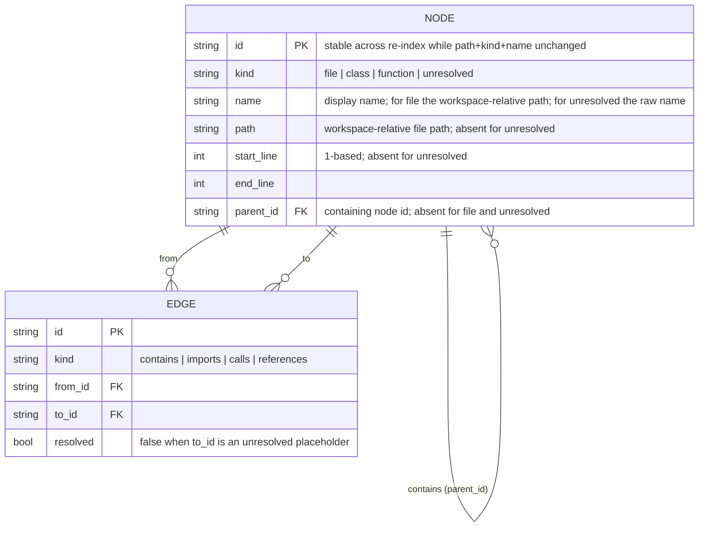

# Code Graph — Data model

The slice of the IR the webview receives. Defined once in Rust; this is the shape, not the
crate layout.

Notes:
- A file's symbols are only sent on expansion (`graph/expand`), so a collapsed file's
  `contains` children are not in the webview's memory.
- Edge `kind` on an unresolved edge is still `calls` or `references`; `resolved: false` is what
  makes it dashed and what the Details region counts as `unresolved`.
- Node `id` stability is what lets expansion, selection and focus survive a refresh (R11).

**Rules**: R3, R4, R11
