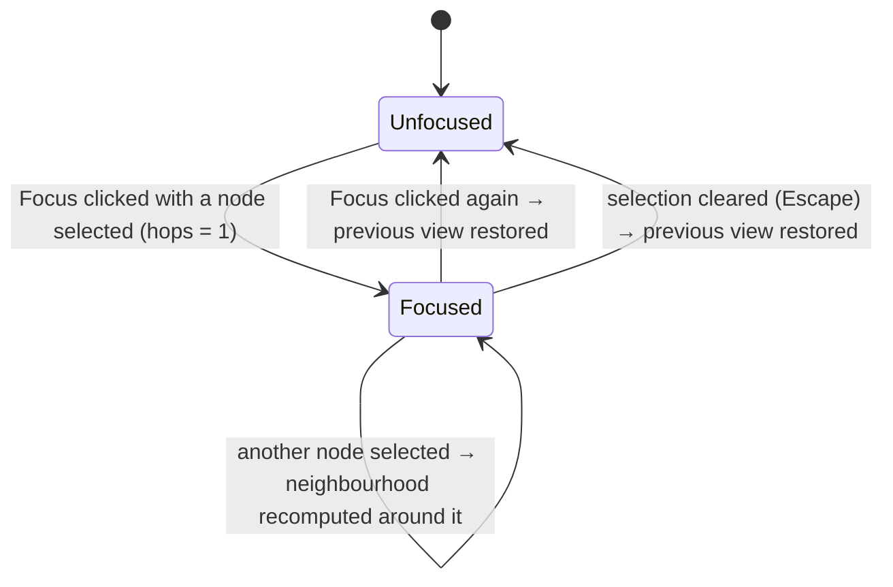

# Code Graph — Flows

## Narrow a large graph

How the narrowing controls combine, and how the size cap is left.

```mermaid
flowchart TD
    A[Indexed graph from sidecar] --> B[Apply path glob]
    B --> C[Apply kind toggles]
    C --> D[Apply expansion state: collapsed files hide their symbols]
    D --> E{Focus active?}
    E -- yes --> F[Keep nodes within Hops of the selected node]
    E -- no --> G[Visible set]
    F --> G
    G --> H{Visible nodes > 2,000?}
    H -- yes --> I[Canvas: 'Graph too large to render (N nodes). Narrow it with a filter.'] --> J[Developer changes a filter] --> B
    H -- no --> K{Visible nodes = 0?}
    K -- yes, and no supported files indexed --> L[Canvas: 'No supported source files found']
    K -- yes, filters excluded everything --> M[Canvas empty; counts read '0 nodes · 0 edges']
    K -- no --> N[Render; counts updated]
```

Abandonment: closing the panel discards all narrowing state; reopening starts from the default
view (R1). A refresh after re-indexing keeps it (R11).

**Rules**: R1, R5, R7, R8, R9, R10, R11

## Focus



**Rules**: R8
