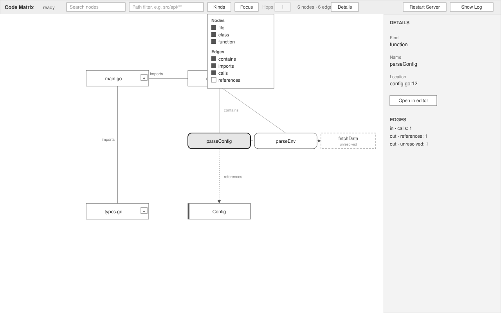
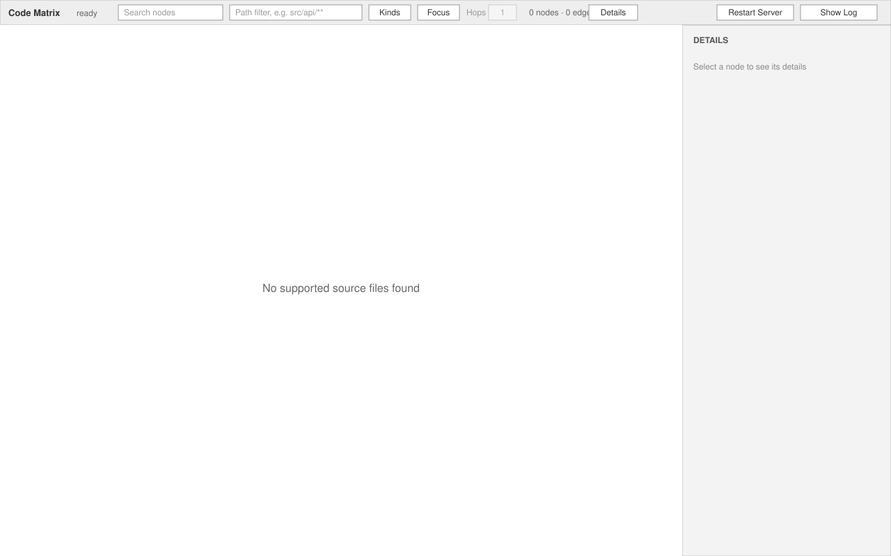
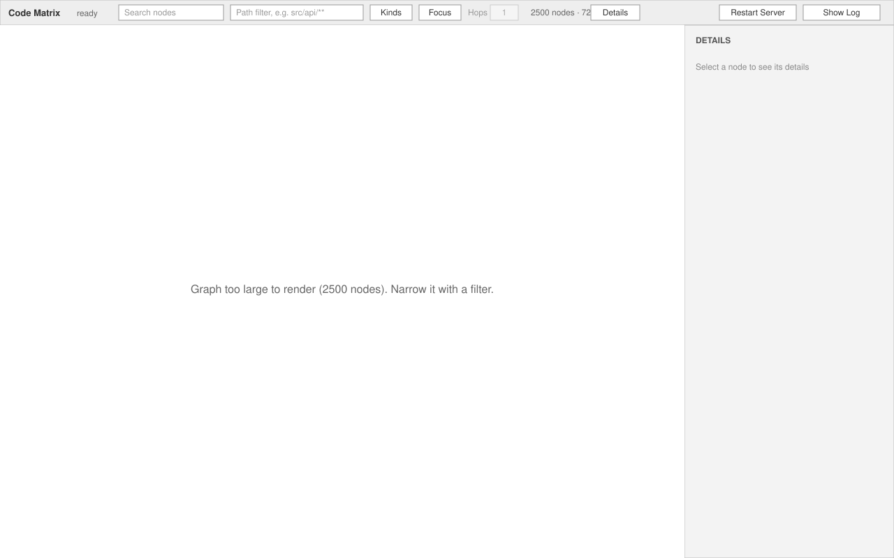

# Code Graph — UI

Renders inside the app shell's graph panel. Regions are the shell's
(`.kernel/specs/features/app-shell/design/ui.md § Graph panel`): this feature fills the
**Toolbar** middle slot, owns the **Main region**, and appends to the **Details region**.

## Toolbar controls

Placed in the toolbar's middle slot, left to right. Enabled only when the shell state is
`ready`.

**Contents**:
- `Search` — text field, placeholder `Search nodes`. Applies on Enter; Escape clears.
  An inline text to its right shows `N matches` or `No matches for '<query>'`.
- `Path` — text field, placeholder `Path filter, e.g. src/api/**`. Applies on Enter; empty
  clears. An invalid glob shows `Invalid pattern: <glob>` inline and keeps the previous filter.
- `Kinds` — button opening a popover of checkboxes: `file`, `class`, `function` under
  **Nodes**; `contains`, `imports`, `calls`, `references` under **Edges**. Default: all on
  except `references`.
- `Focus` — button, enabled only when a node is selected; toggles focus mode. Next to it the
  `Hops` stepper `1 ▸ 3` (default 1), enabled only while focused.
- `N nodes · M edges` — read-only count of what is currently visible, at the slot's right edge.

**States**:
- disabled — shell state is not `ready`; every control greyed.
- idle — fields empty, `Kinds` default, `Focus` disabled, counts for the default view.
- searching — query applied, match count shown, matches highlighted on the canvas.
- filtered — path glob applied; the field keeps the glob; counts reflect the filter.
- invalid glob — `Invalid pattern: <glob>` in place of the counts until the field changes.
- focused — `Focus` shown pressed, `Hops` enabled, counts reflect the neighbourhood.

**Behavior**: see Main region. Filters compose: visible = indexed files ∩ path glob ∩ kind
toggles ∩ expansion ∩ focus neighbourhood. The count and the cap (R9) apply to that result.

**Rules**: R5, R6, R7, R8, R9

## Main region (canvas)

**Contents**: automatically laid-out graph. Node glyphs by kind: `file` is a rectangle with
the file path as label and an expand handle `+` (collapsed) or `−` (expanded) at its right
edge; `class` is a rectangle with a double left border; `function` is a rounded rectangle.
Edges by kind: `contains` thin grey, `imports` solid, `calls` solid with arrowhead,
`references` dotted with arrowhead. An unresolved edge is dashed and ends at a placeholder
node: a dashed rectangle labelled with the raw name and the tag `unresolved`. Selected node
has a 2 px dark outline; search matches have a grey halo.

**States**:
- populated — graph drawn as above. Default view: file nodes and imports edges only.
- empty — `No supported source files found` centred, no nodes. (SVG below.)
- too large — `Graph too large to render (N nodes). Narrow it with a filter.` centred, no
  nodes; toolbar controls stay enabled so a filter can fix it. (SVG below.)
- refreshing — the graph is re-fetched after re-indexing; the previous graph stays visible
  until the new one replaces it, then expansion, filters, focus and selection are re-applied
  to the nodes that still exist. No separate drawing.
- indexing / starting / failed — the shell's overlays cover the canvas; nothing of this feature
  is shown.

**Behavior**:
- Click the `+`/`−` handle on a file node to expand or collapse it. Expanding adds its classes
  and functions with `contains` edges, and any `calls`/`references` edges to nodes already
  visible; collapsing removes them. (R2)
- Single click on any node selects it (shell behaviour) and fills the Details region (R12).
  Double-click or Enter opens its file (shell). For a placeholder node, open does nothing and
  the Details region shows the raw name only.
- Scroll to zoom, drag the background to pan, drag a node to move it for the session only;
  positions are discarded on refresh (R11).
- Search highlights matches among visible nodes and centres on the first (R6).
- Focus hides everything outside N hops of the selected node; clearing restores the previous
  expansion, filter and viewport (R8).
- When the visible count exceeds 2,000 the canvas switches to the too-large state; the next
  filter change that brings it under re-renders (R9).

**Rules**: R1, R2, R3, R4, R6, R8, R9, R10, R11

## Details region additions

Below the shell's `Open in editor` button, when the selected node belongs to this graph.

**Contents**:
- For a `file` node: button `Expand` or `Collapse` (mirrors the handle).
- **Edges** list: one line per edge kind with a count, incoming then outgoing, e.g.
  `in · calls: 1`, `out · references: 1`, `out · unresolved: 1`. Kinds with zero edges are
  omitted.
- For a placeholder node: Kind `unresolved`, Name is the raw name, no Location, no
  `Open in editor`.

**States**: no selection — the shell's `Select a node to see its details`; selected — as above.

**Behavior**: `Expand`/`Collapse` behaves exactly like the node's handle. Clicking an edge-count
line is not interactive in v1.

**Rules**: R2, R4, R12
