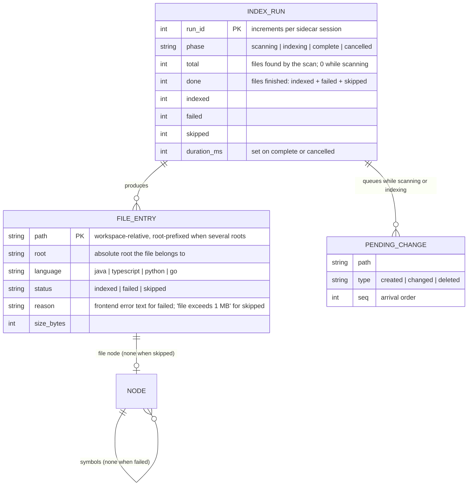

# Workspace Index — Data model

What the `index` store holds beyond the graph nodes and edges that `code-graph` defines
(`.kernel/specs/features/code-graph/design/data-model.md`). In memory only (R11).

Notes:
- `FILE_ENTRY.status` is what the completion summary and the log lines are computed from (R6):
  `indexed` counts into `Indexed N files`; `failed` into `F failed`; `skipped` never into
  either.
- A `failed` entry has exactly one node, its `file` node, and no symbol nodes (R6). A `skipped`
  entry has no node at all; edges that would point into it are Unresolved (R13).
- A single-file re-index (R7) replaces one `FILE_ENTRY` and its nodes in place; node ids stay
  stable while path, kind and name are unchanged, which is what lets `code-graph` keep
  selection and expansion across the refresh.
- `PENDING_CHANGE` is drained in `seq` order at `complete` and dropped at `cancelled` (R8, R9).
- There is exactly one `INDEX_RUN` in `scanning` or `indexing` at any time (R10).

**Rules**: R2, R6, R7, R8, R9, R10, R11, R13
