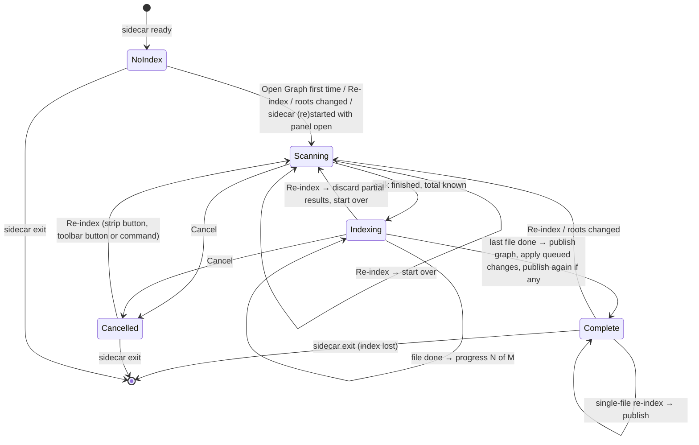
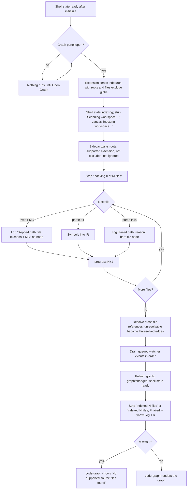
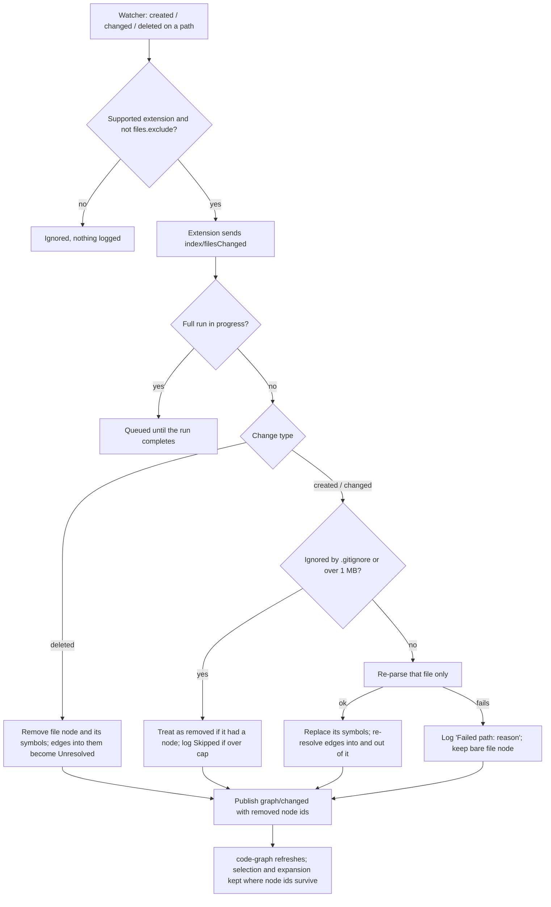
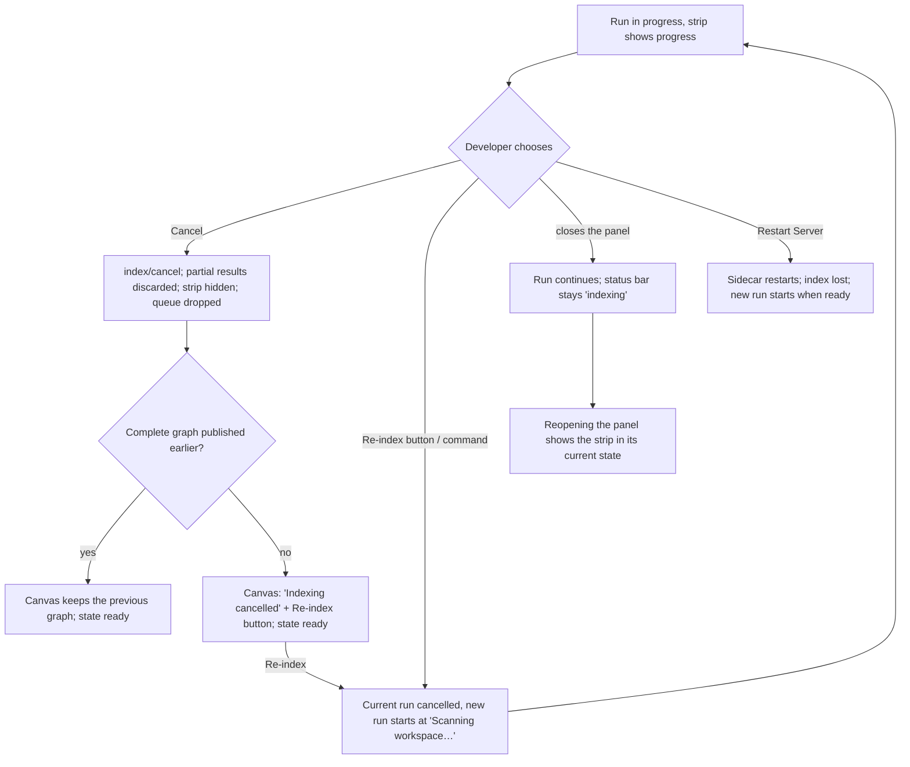

# Workspace Index — Flows

## Full run lifecycle

One run at a time per sidecar. The shell's state (`app-shell/design/flows.md § Sidecar
lifecycle`) is `indexing` from Scanning until Complete or Cancelled.

Notes:
- `Cancelled` keeps whatever graph was published by the last `Complete`; if there was none,
  the panel shows the cancelled overlay.
- Watcher events received in `Scanning` or `Indexing` go to a queue; `Complete` drains it in
  arrival order before the final publish (R8). `Cancelled` drops the queue: those files will be
  seen by the next full run.
- A sidecar exit in any state loses the index; the shell's restart leads back to `NoIndex`, and
  with the panel open the extension starts a run at once (R11, R12).

**Rules**: R1, R3, R4, R8, R9, R10, R11, R12, R14

## Index a workspace (first run)

**Rules**: R1, R2, R3, R4, R6, R8, R13

## Keep the graph current

A rename arrives as `deleted` on the old path then `created` on the new one; the two are
applied in order and published once each. The status bar does not change during a single-file
re-index.

**Rules**: R7, R8, R13, R15

## Re-run or cancel indexing

Abandonment: closing the panel never cancels a run. Closing the window stops the sidecar, and
the next `Open Graph` in a new window starts from scratch (R11).

**Rules**: R1, R9, R10, R11, R12
