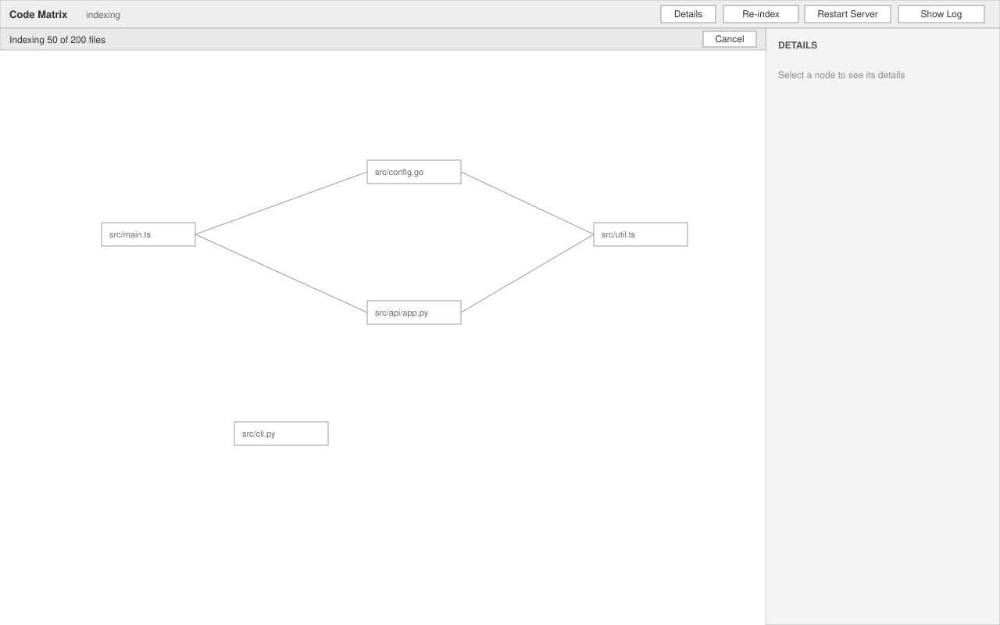
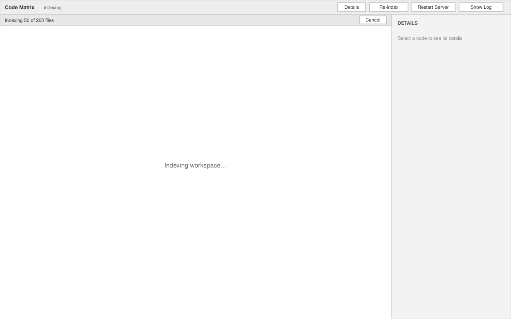
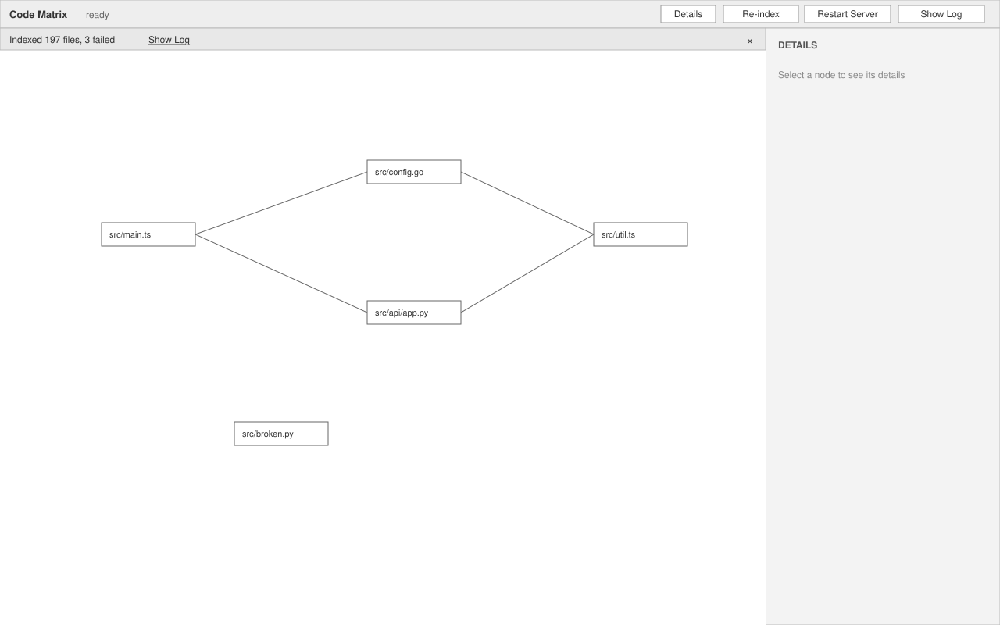
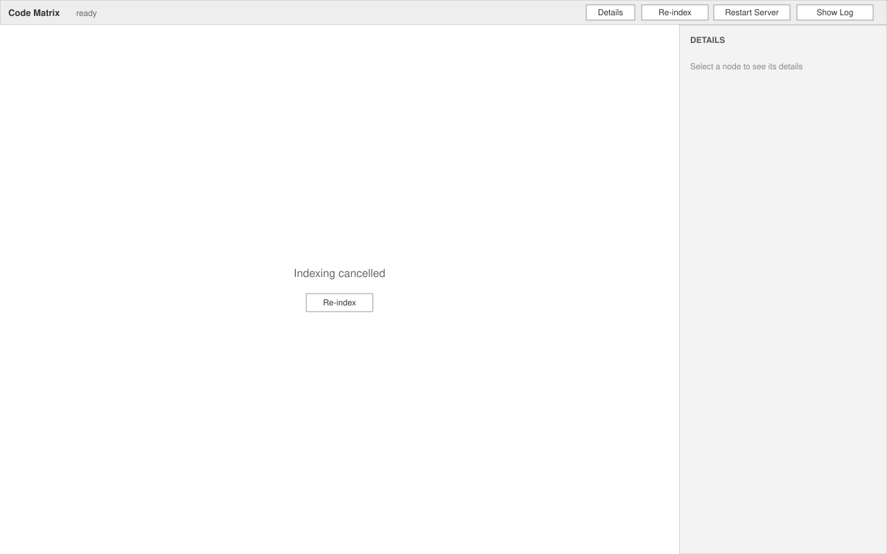

# Workspace Index — UI

Renders inside the app shell's graph panel
(`.kernel/specs/features/app-shell/design/ui.md § Graph panel`). This feature adds one button
to the **Toolbar** right group, draws an **index strip** across the top of the **Main region**,
owns the **cancelled** overlay of the Main region, drives the shell's `indexing` state, and
writes to the `Code Matrix` output channel. It touches nothing in the Details region.

## Toolbar: `Re-index` button

Placed in the toolbar's right group, immediately left of the shell's `Restart Server`.

**Contents**: button `Re-index`. Same action as the command `Code Matrix: Re-index Workspace`.

**States**:
- enabled — shell state is `ready` or `indexing`.
- disabled — shell state is `starting` or `failed`.

**Behavior**: click starts a full run (R1). If a run is already in progress it is cancelled
first and a new run starts from scratch (R10).

**Rules**: R1, R10

## Index strip

A 28 px strip across the top of the Main region, directly under the toolbar, spanning the
canvas width. Shown only while a full run is in progress or just after one finished. It never
covers the Details region.

**Contents**:
- `text-index-progress` — left-aligned text, one of the wordings below.
- `btn-index-cancel` — button `Cancel`, right-aligned, present only while running.
- `link-index-show-log` — link `Show Log`, right of the summary, present only when a run
  finished with at least one failed or skipped file.
- `btn-index-dismiss` — `×` at the far right, present only when a run has finished.

**States**:
- **scanning** — the workspace is being walked and the file count is not yet known. Text
  `Scanning workspace…`, `Cancel` enabled. Usually under a second.
- **running** — text `Indexing N of M files` where N counts files finished (indexed, failed
  or skipped) and M is the total found by the scan; `Cancel` enabled. On the first run of a
  workspace the canvas under the strip is the shell's `Indexing workspace…` overlay; on a
  re-run the previous graph stays visible under the strip and remains interactive (R3, R5).
- **complete** — text `Indexed N files` when nothing failed, `Indexed N files, F failed`
  otherwise, plus `Show Log` when F > 0 or any file was skipped, and `×`. N counts indexed
  files only; failed and skipped files are not in N (R6). The strip stays until dismissed,
  until the next full run starts, or until the panel is closed.
- **hidden** — no run in progress and no undismissed summary. The canvas is fully the
  shell's or `code-graph`'s.

**Behavior**:
- `Cancel` stops the run, discards partial results and hides the strip. With a previous
  complete graph the canvas simply keeps it; with none the canvas switches to the
  **cancelled** overlay below (R9).
- `Show Log` reveals the `Code Matrix` output channel (same as the shell's `Show Log`).
- `×` hides the strip; the graph is unchanged.
- The count is updated at most every 100 ms so the text does not flicker.
- A single-file re-index (R7) shows no strip and no status change: it is expected to finish
  within a few hundred milliseconds, and the graph simply refreshes.

**Rules**: R3, R4, R5, R6, R9

## Main region: cancelled overlay

**Contents**: centred text `Indexing cancelled` with the button `Re-index` beneath it.

**States**:
- **cancelled** — shown only when a run was cancelled and no complete graph has ever been
  published for this sidecar session. If a previous graph exists, cancelling shows nothing
  here (the graph stays).
- Leaves this state as soon as a full run starts (first-run layout) or the sidecar restarts
  (shell `starting`).

**Behavior**: `Re-index` starts a full run exactly like the toolbar button (R1, R9).

**Rules**: R9

## Status bar

This feature does not draw the status bar item; it drives the shell's state (R3).

| Full run phase | Shell state | Status bar text |
|---|---|---|
| scanning, running | `indexing` | `Code Matrix: indexing` |
| complete, cancelled | `ready` | `Code Matrix: ready` |
| single-file re-index | unchanged | unchanged |

**Rules**: R3

## Output channel lines

Written to the `Code Matrix` output channel, one line each, timestamped by the channel.
`<path>` is workspace-relative; with several roots it is prefixed by the root folder name.

| Event | Line |
|---|---|
| full run started | `Index run started: <R> roots` |
| file skipped by size cap | `Skipped <path>: file exceeds 1 MB` |
| file failed | `Failed <path>: <reason>` — reason is the frontend's error text, one line |
| full run complete | `Index run complete: <N> indexed, <F> failed, <S> skipped in <seconds> s` |
| full run cancelled | `Index run cancelled after <N> of <M> files` |
| single-file re-index | `Re-indexed <path>` or `Removed <path>` or `Failed <path>: <reason>` |
| folder added or removed | `Workspace roots changed, starting full run` |

Files excluded by `.gitignore` or `files.exclude` are not logged; they are never visited.

**Rules**: R2, R6, R7, R14
